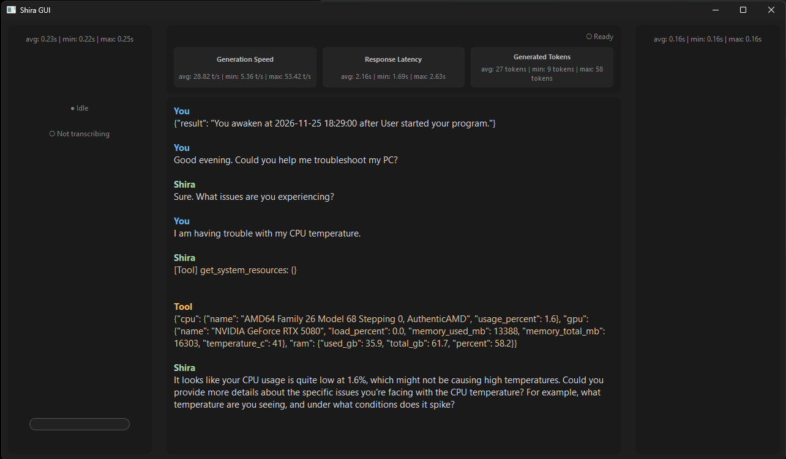

# Shira

**A voice-driven AI assistant that listens, reasons, speaks, and interacts with your PC.**

Shira combines local speech recognition, a llama.cpp-compatible LLM server, streaming text-to-speech, short-term conversation memory, and desktop tools in a Python desktop application.

> **Project status:** Shira is a personal project. Setup currently requires configuring and starting the inference and TTS servers separately. See [Requirements](#requirements) and [Setup](#setup).

<p align="center">
  
</p>

## Features

- **Speech recognition:** NVIDIA Parakeet (NeMo) with Silero VAD. ASR uses the CPU by default, leaving the GPU available for other workloads.
- **LLM conversation:** streams responses from a llama.cpp-compatible chat-completions endpoint and supports tool calling. Vision support depends on the selected model/server.
- **Streaming speech output:** sends responses to a Breeze TTS server and plays the returned audio.
- **Short-term memory:** summarizes older conversation context through a separate LLM endpoint when the configured token threshold is reached.
- **Desktop tools:** retrieves the current time and system resource usage, reads/sets RGB lighting through OpenRGB, and captures monitor screenshots for vision-capable models.
- **Desktop GUI:** PySide6 interface with conversation display, live transcript, microphone level, and latency/token statistics.

## Architecture

Shira runs its main stages in separate processes and passes messages between them using multiprocessing queues.

```text
 microphone ──► ASR ──► LLM ──► TTS ──► speakers
                 │       │
                 │       ├──► tools (time, system resources, RGB, screenshots)
                 │       └──► short-term memory (summarizer endpoint)
                 └────────────► GUI (transcript, status, conversation, stats)
```

### Project layout

| Path | Responsibility |
| --- | --- |
| `shira.py` | Application entry point; starts the worker processes and GUI |
| `asr.py` | Microphone capture, voice activity detection, and transcription |
| `llm.py` | Conversation loop, streamed inference, tool calls, and history persistence |
| `short_term_memory.py` | Summarizes older conversation context |
| `tts.py` | Requests speech synthesis and plays streamed audio |
| `tools.py` | Tool schemas, implementations, and dispatch |
| `config.py` | Paths, server endpoints, environment-based settings, and prompt loading |
| `prompts/` | System and short-term-memory prompts |
| `gui/` | PySide6 desktop interface |
| `tests/` | Automated tests for core logic |
| `.github/workflows/ci.yml` | GitHub Actions lint and test workflow |

## Requirements

- Python 3.10 or newer. The current CI workflow tests Python 3.10 and 3.11 on Ubuntu and Windows.
- A working microphone and speakers.
- PyTorch installed with a build compatible with your CUDA setup if you intend to use NVIDIA GPU acceleration.
- Three separately running services:
  - A llama.cpp-compatible server for the main conversation.
  - A second llama.cpp-compatible server for short-term-memory summarization.
  - A Breeze TTS server.
- An NVIDIA GPU is recommended for the overall experience. ASR defaults to CPU and can be configured to use CUDA.

The main LLM must support tool calling for the tools to work. A vision-capable model/server is required for screenshot-based vision requests. The two LLM endpoints may use the same model, although they serve separate roles.

## Setup

### 1. Clone the repository

```bash
git clone https://github.com/Tim-Dieringer/ai-agent-shira.git
cd ai-agent-shira
```

### 2. Create and activate a virtual environment

Use Python 3.10 or newer.

| Platform | Create environment |
| --- | --- |
| Windows | `py -3.10 -m venv .venv` |
| Linux / macOS | `python3.10 -m venv .venv` |

Activate it in each new terminal session:

| Shell | Activation command |
| --- | --- |
| Windows PowerShell | `.venv\Scripts\Activate.ps1` |
| Windows cmd | `.venv\Scripts\activate.bat` |
| Linux / macOS | `source .venv/bin/activate` |

### 3. Install PyTorch and Python dependencies

Install the PyTorch build that matches your CUDA setup by following the [official PyTorch installation selector](https://pytorch.org/get-started/locally/).

Then install the project dependencies:

```bash
python -m pip install --upgrade pip
pip install -r requirements.txt
```

On first launch, NeMo downloads the `nvidia/parakeet-tdt-0.6b-v2` ASR model. Make sure you have sufficient disk space and an internet connection for the initial download.

### 4. Start the required services

Start the following services before launching Shira. The commands below are examples; adjust executable names and model paths to match your installation.

| Service | Default endpoint | Example command |
| --- | --- | --- |
| Main LLM | `127.0.0.1:8080` | `llama-server -m <path-to-main-model.gguf> --port 8080` |
| Memory LLM | `127.0.0.1:8081` | `llama-server -m <path-to-memory-model.gguf> --port 8081` |
| Breeze TTS | `127.0.0.1:8083` | `breeze-server <path-to-breeze-model.gguf> --host 127.0.0.1 --port 8083` |

The LLM servers are expected to expose an OpenAI-compatible chat-completions endpoint. The TTS server must expose the speech endpoint expected by Shira.

### 5. Optional: configure OpenRGB

Install [OpenRGB](https://openrgb.org/) and start its SDK server to enable the RGB tools. Without it, RGB operations may report an error; the other assistant features can still be used.

### 6. Launch Shira

From the repository directory, with the virtual environment activated:

```bash
python shira.py
```

## Configuration

Shira reads its settings from environment variables. Defaults are defined in `config.py`.

| Variable | Default | Description |
| --- | --- | --- |
| `SHIRA_USER_NAME` | `User` | Name used in prompts and tool descriptions |
| `SHIRA_ASSISTANT_NAME` | `Shira` | Assistant name used in prompts |
| `SHIRA_ASR_DEVICE` | `cpu` | ASR device: `cpu` or `cuda` |
| `SHIRA_ASR_THREADS` | `min(8, CPU cores)` | Number of CPU threads used by ASR |
| `SHIRA_LLM_URL` | `http://127.0.0.1:8080/v1/chat/completions` | Main LLM endpoint |
| `SHIRA_STM_URL` | `http://127.0.0.1:8081/v1/chat/completions` | Short-term-memory LLM endpoint |
| `SHIRA_TTS_HOST` | `127.0.0.1` | TTS server host |
| `SHIRA_TTS_PORT` | `8083` | TTS server port |
| `SHIRA_TTS_VOICE` | `A warm, friendly woman with a clear delivery.` | Plain-text voice description sent to TTS |
| `SHIRA_LLM_MAX_TOKENS` | `1024` | Maximum tokens per LLM reply |
| `SHIRA_LLM_TIMEOUT` | `60` | Main LLM request timeout in seconds |
| `SHIRA_COMPRESS_AT_TOKENS` | `60000` | Approximate context threshold that triggers history summarization |
| `SHIRA_STM_MAX_TOKENS` | `5000` | Maximum tokens for the memory summary |
| `SHIRA_STM_TIMEOUT` | `300` | Memory summarization request timeout in seconds |
| `SHIRA_CPU_NAME` | Auto-detected | CPU name reported by the system-resource tool |
| `SHIRA_MONITOR_NOTES` | Empty | Optional monitor/hardware notes supplied to the screenshot tool |
| `SHIRA_LOG_LEVEL` | `INFO` | Logging verbosity: `DEBUG`, `INFO`, `WARNING`, or `ERROR` |

Example in Windows PowerShell:

```powershell
$env:SHIRA_USER_NAME = "Alex"
$env:SHIRA_TTS_VOICE = "A calm, low male voice with a slow delivery."
python shira.py
```

The LLM and TTS endpoints default to loopback addresses. You can override them, but configuring a remote endpoint means relevant conversation content, prompts, screenshots, or audio requests may be sent to that remote service.

## Available tools

| Tool | Description |
| --- | --- |
| `get_time` | Returns the current date/time and session runtime |
| `get_system_resources` | Reports CPU, GPU, and RAM usage |
| `get_rgb_color` / `set_rgb_color` | Reads or changes RGB lighting through OpenRGB |
| `look_at_screen` | Captures a selected monitor and attaches the screenshot to the next message |

To add a tool, define its schema in `TOOLS` in `tools.py`, implement its behavior, and add its handler to `dispatch()`.

## Tested Configuration

This project has been tested with the following configuration:

| Component | Tested Configuration |
| Operating System | Windows 11 |
| Inference Server | ik_llama.cpp |
| LLM Model | Qwen3.8 27B |
| TTS Model | Breeze TTS 2 |

## Development

The automated tests focus on core logic and are designed to run without a GPU, microphone, display, PyTorch, NeMo, or PySide6.

Create/activate a virtual environment, then install the development dependencies:

```bash
pip install -r requirements-dev.txt
pytest
ruff check .
```

The GitHub Actions workflow runs Ruff and the test suite on pushes to `main` and on pull requests. The test matrix currently covers Ubuntu and Windows with Python 3.10 and 3.11.

## Roadmap

- Text input field
- RAG Memory Recall System
- Additional tools such as limited internet access

## Privacy and local data

Shira is designed to run with local services, and its default LLM and TTS endpoints use `127.0.0.1`. **Local operation depends on how you configure the endpoints.** If you point an endpoint to another machine or a hosted service, data sent to that service is no longer confined to your computer.

The application stores runtime data under `memory/`, which is excluded from Git by `.gitignore`:

- `conversation_history.json` and `conversation_log.json` store conversation data.
- `memory/screenshots/` stores screenshots created by the `look_at_screen` tool.

Screenshots can contain sensitive information from your display. Review them before sharing logs or diagnostic files. To clear the locally stored conversation data and screenshots, close Shira and delete the relevant files in `memory/`.

## Troubleshooting

| Symptom | What to check |
| --- | --- |
| Shira remains on “Waiting for breeze-server” | Confirm the Breeze TTS server is running and that `SHIRA_TTS_HOST` / `SHIRA_TTS_PORT` match its address. |
| LLM request errors | Confirm the main and memory LLM servers are running and check `SHIRA_LLM_URL` / `SHIRA_STM_URL`. |
| RGB tools fail | Confirm OpenRGB is installed and its SDK server is running. |
| Noisy or excessive logs | Adjust `SHIRA_LOG_LEVEL`. |
| ASR initialization/download fails | Check the NeMo model download, Python/PyTorch compatibility, available disk space, and selected ASR device. |

## Limitations

- Requires separately configured inference and TTS servers.
- Performance depends on the selected LLM, ASR and TTS models and available hardware.
- Vision capabilities depend on model and server support.
- RGB functionality requires a compatible OpenRGB setup.
- Currently developed and tested primarily on Windows.

## License

This project is distributed under the MIT License; see [LICENSE](LICENSE). The models, model weights, and external servers used with Shira may have separate terms and licenses. Check those terms before downloading, using, or redistributing them.

## Acknowledgements

Shira builds on several open-source projects and model ecosystems, including NVIDIA NeMo/Parakeet, Silero VAD, llama.cpp-compatible servers, Breeze TTS, PySide6, and OpenRGB. Please consult each project's own documentation and license.
